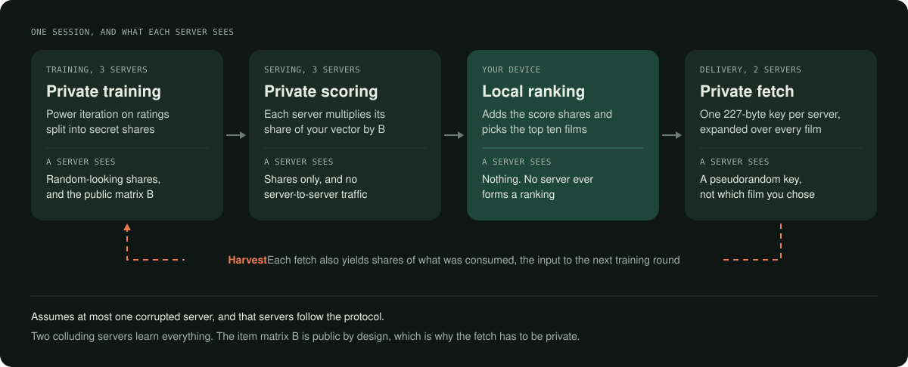
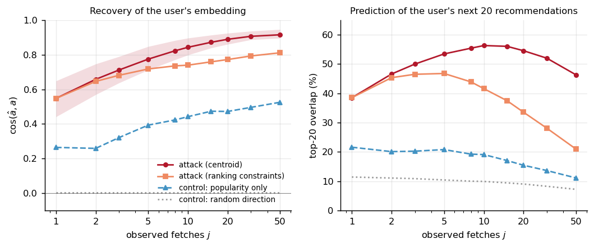

# OblivRec

**A film recommender in which no server can read your ratings, and no server learns which film you fetch.**

[](https://github.com/mainak9093/privacy-preserving-recommendation/actions/workflows/tests.yml)

[Final report (PDF)](report/final.pdf) · [Slides](report/slides/OblivRec_final_presentation.pdf) · [Results](docs/results.md) · [Architecture](docs/architecture.md) · [Threat model](docs/threat-model.md)



A recommender learns about you twice. It reads your ratings to train a model, and it sees what you
pick when you fetch it. OblivRec protects both. Three servers train a matrix-factorisation model on
ratings split into secret shares, so no single server can read them. Your own device ranks the
results and then fetches each film by private information retrieval, so the servers answering
cannot tell which film you asked for.

It composes two published systems that each solve one half:
[Nudge](https://www.usenix.org/conference/usenixsecurity26/presentation/henzinger) (USENIX Security
2026) for training, and [Pirsona](https://petsymposium.org/popets/2021/popets-2021-0059.php) (PoPETs
2021) for delivery. Every protocol is implemented from the papers in C++17 with no cryptographic
library, and the system runs end to end on MovieLens-100K. The contribution is the composition and
the measurement of it: what it costs, what leaks without it, and where it breaks.

Built by **Shravan Agrawal, Shrasti Dwivedi and Mainak Sarkar** for CS670, Cryptographic Techniques
for Privacy Preservation, at IIT Kanpur, 2026. This is a research prototype. It has not been
audited and is not for production use.

**Built with:** C++17 · AES-NI · 2-of-3 replicated secret sharing · distributed point and comparison
functions · private information retrieval · TCP · Python (NumPy, Matplotlib, scikit-learn) · LaTeX

---

## What we found

| Question | Measured answer |
|---|---|
| What does composing the two halves cost? | Exactly their sum: FULL = B2 + B3 − B1 = 64,760,124 bytes, asserted to the byte. On a 30 ms, 100 Mbit/s link, private delivery +2.5 ms and private training +96 ms per session, with one training run shared by 943 users. |
| Does the fetch really have to be private? | Yes. Ten fetches seen in the clear recover a user's private embedding to cosine 0.84 (popularity control 0.44), enough to predict 56% of that user's next twenty recommendations. |
| Would something cheaper do? | No. Decoys at 40 per query, five times the traffic: the attack only falls from 0.84 to 0.71. Nudge's own differential privacy at ε = 1: quality −71%, and the attack gets stronger, 0.82 to 0.92. |
| Where does the cost go? | Not where you would guess: truncation 68.6 to 74.4% of rounds, the FSS comparison gate 3.1%. The breakdown accounts for every round and byte, with a residual of zero. |
| Does Nudge's central theorem hold in practice? | Yes: input matrix 4× larger, traffic +4.4%, rounds unchanged at 2,686. |
| What does revealing nothing cost? | 0.0018 to 0.0041 nDCG@20, for 5.3× the rounds. It also rules out a 64-bit ring: the comparison gate's mask needs at least 81 bits. |
| What goes against us? | On that same link, downloading the whole catalogue is 4.6× faster than our unbatched private read, because we pay one round trip per film. Batching would reverse it, and we did not build it. |
| What can a malicious client do? | Until we closed it, one client could cast a vote of any weight, and sixteen colluders with unchecked weights take nDCG@20 from 0.4536 to 0.0021. A one-round check closes weight inflation but not redistribution. |
| Is anything visible on the wire? | Nothing we could find: every query frame 228 B whatever the film, a classifier on the raw bytes stays at chance, and server time is bounded below 2% of a call. |



*Reconstruction attack, all 943 users. An observer sees only which items a user fetched. The gap
above the popularity control is what is learned about the individual rather than about what is
popular.*

Every number above is recomputed from the committed data by
[`bench/scripts/check_claims.py`](bench/scripts/check_claims.py), and every figure is drawn from raw
rows in [`bench/results/`](bench/results/). [All twelve figures, explained →](docs/results.md)

---

## See it run

The demo serves a model trained privately with the normaliser that reveals nothing. This is the
program's real output for user 42:

```text
[2] each server scored 1682 items locally. B is public, so this is
    a linear map on shares: no communication, no rounds.
[3] user reconstructed the score vector and took the top 10 locally.
    The servers never computed a ranking, so they cannot know it.

[4] fetching each recommendation by two-server DPF-PIR:

    rank item   score (2t-scaled)      title (fetched privately)
    0    0      3985510293721          Toy Story (1995)
    1    94     3253835172460          Aladdin (1992)
    2    172    3003783912317          Princess Bride, The (1987)
    3    285    2832029832122          English Patient, The (1996)
    4    236    2784941524260          Jerry Maguire (1996)
    5    70     2682062760624          Lion King, The (1994)
    6    203    2626050118158          Back to the Future (1985)
    7    14     2564579331556          Mr. Holland's Opus (1995)
    8    317    2432749438261          Schindler's List (1993)
    9    116    2292504447885          Rock, The (1996)

All 10 records fetched privately and verified byte-exact
against a cleartext lookup. Each fetch cost one 227-byte DPF key
per server against a 2048-entry domain.
```

---

## Why the engineering is worth a look

**The cryptography is written from the papers.** A distributed point function and a distributed
comparison function built on fixed-key AES through AES-NI, replicated secret sharing with
pseudorandom zero shares, a three-round truncation protocol, a comparison gate that finds the top
bit of a secret value, and an inverse square root under sharing.

**It is verified exhaustively, not sampled.** The point function was checked for every secret index
against every input in every domain up to 16 bits: 7.16 × 10⁹ comparisons, all correct. All 18 test
binaries also run in a hardened build with undefined-behaviour traps, checked iterators and
bounds-checked spans. Each private component is tested against a cleartext twin.

**It measures quality as well as cost, and that caught what cost could not.** The first run of
the no-leak training path scored 0.3428 against 0.4513. That would have been reported as "revealing
nothing costs 24% of recommendation quality". The real cause was a comparison gate given too narrow
a range, which clamps silently. Rounds and bytes were identical either way, so no cost benchmark
could have seen it. With the range fixed, the gap is 0.0020.

**Other bugs that only tests found:**

- A malformed DPF key with an invalid party byte silently evaluated as the other party.
- The first DPF seeded its keys from a Mersenne Twister, which can be reconstructed from its output.
  Key material now comes from the operating system's generator, and a failure aborts.
- Out-of-step pseudorandom counters produced well-formed shares of the wrong value, silently.
- Quantising a product instead of its factors changed 1,650 of 1,682 reference scores by an amount
  too small for any tolerance check to notice. Serving is now checked by exact equality.

**The numbers cannot drift from the data.** Benchmarks append raw rows tagged with their commit.
Figures are generated and never edited. A checker recomputes the stated numbers and fails if the
report, the slides or these documents disagree. Our own negative results are reported in the body,
not left out.

### Where to read next

| You have | Read |
|---|---|
| 5 minutes | [Results, with every figure explained](docs/results.md) |
| 15 minutes | [Architecture: how the system works, and a map of the code](docs/architecture.md) |
| A security question | [Threat model and simulation sketch](docs/threat-model.md) |
| An afternoon | [Final report, 40 pages (PDF)](report/final.pdf) |
| Code to review | [The DPF](src/dpf/dpf.cpp) and [its invariant test](tests/test_dpf_invariant.cpp), [truncation](src/mpc/nonlinear/trunc.cpp), [the comparison gate](src/mpc/nonlinear/msnzb.cpp), [power iteration](src/mf/factor.cpp), [the attack](model/attack.py) |

Everything else is indexed in [`docs/README.md`](docs/README.md).

---

## Build and run

Windows 11 with MSYS2's mingw64 toolchain. Randomness (Windows CNG) and sockets (Winsock) are Windows
APIs, so other platforms are not supported.

**You need**

- MSYS2 with mingw64 g++ and `mingw32-make`, with `C:\msys64\mingw64\bin` **first** on `PATH`.
  Tested with g++ 16.1.0 and GNU Make 4.4.1.
- Python 3.13 as `py -3.13`, with `numpy`, `matplotlib` and `scikit-learn`.
- For the report only, a TeX distribution with `latexmk`.

**Tests only** (about a minute to build, seconds to run)

```bash
export PATH=/c/msys64/mingw64/bin:$PATH      # Git Bash
mingw32-make test
```

**Everything, from a clean checkout**

```bash
mingw32-make reproduce
```

This fetches MovieLens-100K, builds, runs all 18 test binaries, trains the 18 private models, runs
the leakage and malicious-client studies and every benchmark, then draws the 12 figures and builds
the report. It takes about 13 minutes. `mingw32-make reproduce-bg` followed by `mingw32-make watch`
runs it in the background with a progress bar.

If the download fails (no network, a proxy, or a certificate your Python does not trust),
`scripts/fetch_data.py` prints what to do: download
[ml-100k.zip](https://files.grouplens.org/datasets/movielens/ml-100k.zip) by hand, place it in
`data/`, and run it again. The checksum is verified either way.

**Piece by piece**

| Command | What it does |
|---|---|
| `py -3.13 scripts/fetch_data.py` | MovieLens-100K and 1M into `data/`, checksum-verified |
| `py -3.13 model/export.py` | the cleartext oracle, and the fixed-point model the demo serves by default |
| `mingw32-make test` | builds and runs the 18 test binaries |
| `mingw32-make check` | the same tests under the hardened build |
| `mingw32-make test-exhaustive` | the full DPF sweep up to 16 domain bits (slow) |
| `./build/train.exe --d 16 --ell 10 --b 128 --normalizer fss --out model/out/B_private_fss_b128_ell10.bin` | private training with the normaliser that reveals nothing |
| `py -3.13 model/score_private.py` | scores the trained models and writes the files the demo reads |
| `./build/demo.exe --user 42 --k 10 --a model/out/A_private_fss_b128_ell10.bin --b model/out/B_private_fss_b128_ell10.bin --expect model/out/top10_u42_private_fss_b128_ell10.txt` | the demo above, serving that model |
| `mingw32-make demo-net` | the same protocol across three server processes over TCP |
| `mingw32-make distinguisher` | records 1,800 queries and tests the wire bytes against a classifier |
| `mingw32-make bench` | every benchmark, appending rows to `bench/results/` |
| `mingw32-make figures` | redraws all 12 figures from the committed rows |
| `py -3.13 bench/scripts/check_claims.py` | recomputes the headline numbers and checks the documents state them |
| `mingw32-make report` | builds `report/final.pdf` |

A rerun appends rows at the current commit, and the figures use the newest commit's rows. Absolute
times drift with a laptop's thermal state, so milliseconds will differ. Rounds, bytes and quality
will not.

---

## Repository layout

```text
include/oblivrec/   public headers, one per component
src/dpf/            distributed point and comparison functions
src/mpc/            replicated sharing, truncation, comparison gate, inverse square root
src/mf/             power iteration under sharing, both normalisers, the truncation schedule
src/serve/ src/pir/ scoring, the catalogue, the PIR server and client, the harvest
src/net/            TCP framing, transcript recorder, channel-level network emulation
src/apps/           the three servers, the training driver, the demo, the distinguisher's probe
tests/              18 test binaries, each checking a component against a cleartext twin
bench/              7 benchmarks, raw results in bench/results/, figures from bench/scripts/
model/              cleartext oracle, model export, the attack, the DP and poisoning studies
report/             the final report, survey, mid-term reports, slides and their sources
docs/               results, architecture, threat model, and the project's working history
design/             the original design draft and its decisions log
references/         the papers we read, with links
third_party/nudge/  Nudge's reference implementation, kept for reading and never built
```

---

## What we do not claim

- **Semi-honest security with at most one corrupted server.** Two colluding servers learn
  everything, and a server that deviates from the protocol is out of scope.
- **A simulation sketch, not a proof.** The revealing normaliser is only secure against a weaker
  functionality, and every 64-bit quality number comes from it.
- **MovieLens-100K only.** Larger scales are analysed from public parameters, not run.
- **Emulated networks on one laptop.** Wide-area numbers come from channel-level emulation.
- **The harvest is built and tested, but the running servers do not retrain from it.** Every model
  here was trained on ratings read from disk.
- **A malicious client can still redistribute vote weight with a forged key**, and full-domain
  evaluation remains a denial-of-service lever. Closing both needs an audit we did not build.

Section 9 of the [report](report/final.pdf) has the full list.

---

## Credits

Course project for CS670 at IIT Kanpur, by Shravan Agrawal, Shrasti Dwivedi and Mainak Sarkar. The
state frozen for the course is tag [`v1.0-final`](https://github.com/mainak9093/privacy-preserving-recommendation/releases/tag/v1.0-final).

- [Nudge](https://www.usenix.org/conference/usenixsecurity26/presentation/henzinger): Henzinger,
  Dauterman, Corrigan-Gibbs and Boneh. Its MIT-licensed reference implementation sits in
  [`third_party/nudge/`](third_party/NOTICE.md) as reading material. No build target compiles or
  links it, and OblivRec's own implementation is in `src/`.
- [Pirsona](https://petsymposium.org/popets/2021/popets-2021-0059.php): Vadapalli, Bayatbabolghani
  and Henry.
- [MovieLens-100K](https://grouplens.org/datasets/movielens/100k/): GroupLens, University of
  Minnesota. Fetched by the build and not redistributed here.
