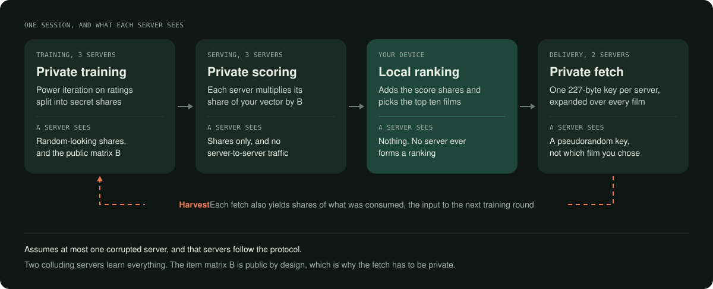
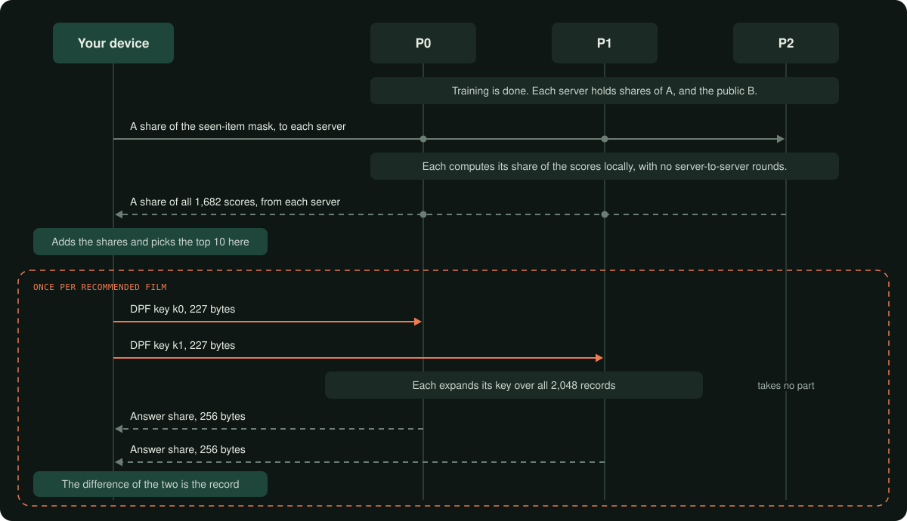

# Architecture

How OblivRec works as built, and where each piece lives in the code. The
[final report](../report/final.pdf) has the full treatment in Sections 4 and 5, and the protocols as
pseudocode in Appendix A.



## Who holds what

| Party | Holds | Does |
|---|---|---|
| `P0`, `P1` | Replicated shares of the ratings `U` and user embeddings `A`, the public item matrix `B`, the public catalogue | Train, score, answer private reads |
| `P2` | The same shares and public data | Train and score, takes no part in private reads |
| The user | Their own score shares and DPF keys | Reconstructs scores, ranks locally, recombines each fetched record |

A secret `x` is split as `x = x0 + x1 + x2` over the ring of integers modulo `2^b`, and party `Pi`
holds the pair `(xi, xi+1)`. Any two parties can reconstruct, while one party holds only two
uniformly random values. Everything that follows assumes at most one party is corrupted and that all
of them follow the protocol.

## One session



Each fetch sends one 227-byte key to each PIR server and gets back a 256-byte answer share from each. `P2` holds the catalogue too but takes no part in the fetch, because the DPF is a two-party primitive.

## Training

Training runs Nudge's power iteration on shared ratings. Ratings are integers, held at scale zero,
so the two matrix products need no truncation of their own.

```text
for each of d components:
    v = shares of a small random start vector
    v = Normalize(SetOrthogonal(v, B so far))
    repeat ell times:
        w = U * v                     1 round, 3 elements per user
        v = transpose(U) * w          1 round, 3 elements per item
        v = Truncate(v, fixed shift)  3 rounds
        v = SetOrthogonal(v, B)       local products, then 1 or 2 truncations
        v = Normalize(v)              see below
    open v as the next row of B       1 round, public by design
```

Opening each row of `B` is Nudge's design and not an oversight. It makes orthogonalisation local,
because every product is then a share times a public value. Keeping `B` shared makes one small
orthogonalisation cost 6 rounds and 1,800 bytes where the public version costs none, which
`tests/test_mf.cpp` measures. The price of a public `B` is [the reconstruction attack](results.md#why-the-fetch-has-to-be-private).

**Two normalisers, behind one interface.** Normalising needs `1/||v||` on a shared `v`.

- `FssNormalizer` follows the paper. A comparison gate finds the most significant non-zero bit of
  `||v||^2`, which seeds an inverse square root, and four Newton steps refine it to a worst relative
  error of 1.41e-06. It reveals nothing, and it needs a 128-bit ring because the gate's mask does not
  fit in 64 bits.
- `RevealNormNormalizer` opens `||v||^2` and rescales by a public constant. It is far cheaper, and it
  leaks one scalar per call. Every result records which normaliser produced it.

**A schedule that proves it fits.** Whether a deferred truncation schedule fits depends on `b`, `t`,
`n` and `d`, so the schedule is derived from public parameters at start-up, asserted to leave at
least eight spare bits, and refuses to run otherwise. At `b = 64` on MovieLens-100K training uses the
immediate schedule, with 21 bits to spare. At `b = 128` the deferred schedule fits with 67.

## Serving and delivery

**Scoring needs no communication.** Each server multiplies its share of the user's vector by public
`B`. The user also sends shares of a mask carrying a large negative value at items already rated, so
no server learns which those are.

**Selection happens on the user's device.** The original design had an oblivious top-k protocol. We
cut it, because once the user reconstructs the scores, no server learns the selection anyway.

**Records are fixed width.** MovieLens-100K's 1,682 items pack into 256-byte records and pad to a
domain of 2,048, so reply length cannot reveal the record.

**The read.** The user generates DPF keys for the point function that is 1 at the wanted index and
sends one to each of `P0` and `P1`. Each server expands its key over every record and takes an inner
product with the catalogue. The difference of the two answers is the record. A key is logarithmic in
the catalogue, at 1 + 4 + 16 + 18 bytes per domain bit + 8 bytes, and the server's work is linear,
because any shortcut would reveal the index.

**The harvest closes the loop.** The expansion a PIR server computes is its share of the indicator
vector of the fetched item, normally thrown away. `AnswerAndHarvest` keeps it, an accumulator sums it
over queries, and a one-round conversion turns the two servers' shares into the replicated form
training consumes. A one-round check confirms each query carries weight exactly one. All of this is
implemented and tested through real PIR queries. The networked servers do not yet accumulate across
sessions or retrain from it.

## What each operation costs

| Operation | Rounds | Communication | Where |
|---|---|---|---|
| Shared matrix-vector product | 1 | 3 elements per output entry, whatever the matrix size | `src/mpc/mpc.cpp` |
| Truncation | 3 | 8 elements per value | `src/mpc/nonlinear/trunc.cpp` |
| Normalise, revealing | 5 | | `src/mf/factor.cpp` |
| Normalise, no leak | 58 | | `src/mf/factor.cpp` |
| Comparison gate, any number of thresholds | 2 | 5 elements per value | `src/mpc/nonlinear/msnzb.cpp` |
| Open a row of `B` | 1 | 3 elements per item | `src/mf/factor.cpp` |
| Scoring | 0 | none between servers | `src/serve/serve.cpp` |
| One private read | 1 round trip | 483 B per server: a 227 B key up, a 256 B record's worth of answer down | `src/pir/pir.cpp` |
| Harvest weight check | 1 | 2 elements per query | `src/pir/harvest.cpp` |
| Harvest conversion | 1 | 3 elements per item | `src/pir/harvest.cpp` |

One training run at `d = 16`, `ell = 10` on MovieLens-100K:

| Configuration | Rounds | Traffic | Reveals |
|---|---|---|---|
| Revealing normaliser, `b = 64` | 2,686 | 64.75 MB | one scalar per normalisation |
| Revealing normaliser, `b = 128` | 2,191 | 129.33 MB | one scalar per normalisation |
| No-leak normaliser, `b = 128` | 11,519 | 143.94 MB | nothing beyond `B` |

## Map of the code

| Component | Header | Source | Test |
|---|---|---|---|
| Distributed point function | `dpf.hpp` | `src/dpf/dpf.cpp` | `test_dpf_invariant`, `test_dpf_exhaustive`, `test_dpf_serialize` |
| Distributed comparison function | `dcf.hpp` | `src/dpf/dcf.cpp` | `test_dcf` |
| AES-NI generator, OS randomness | `prg.hpp`, `csprng.hpp` | `src/common/` | `test_aes`, `test_csprng` |
| Rings, fixed point, shares | `ring.hpp`, `fixedpoint.hpp`, `share.hpp` | headers | `test_ring` |
| Three-party substrate | `mpc.hpp`, `mvp.hpp` | `src/mpc/mpc.cpp`, `src/mpc/mvp.cpp` | `test_mpc`, `test_mf` |
| Truncation | `nonlinear.hpp` | `src/mpc/nonlinear/trunc.cpp` | `test_trunc` |
| Comparison gate, inverse square root | `msnzb.hpp` | `src/mpc/nonlinear/msnzb.cpp` | `test_msnzb` |
| Cleartext normalise reference | `nonlinear.hpp` | `src/mpc/nonlinear/normalize.cpp` | `test_normalize` |
| Power iteration, normalisers, schedule | `factor.hpp`, `mf.hpp` | `src/mf/` | `test_factor`, `test_mf` |
| Scoring and masking | `serve.hpp` | `src/serve/serve.cpp` | `test_serve` |
| Catalogue and private read | `catalogue.hpp`, `pir.hpp` | `src/pir/` | `test_catalogue`, `test_pir` |
| Harvest and weight check | `harvest.hpp` | `src/pir/harvest.cpp` | `test_harvest` |
| TCP framing, transcripts, network profiles | `channel.hpp`, `wire.hpp`, `netprofile.hpp` | `src/net/` | `test_channel` |
| Benchmark harness | `bench.hpp` | `bench/bench_*.cpp` | |
| Programs | | `src/apps/`: `train`, `demo`, `server`, `probe` | `mingw32-make demo-net` |

Python, under [`model/`](../model/): the cleartext oracle (`mf.py`), ranking metrics (`metrics.py`),
the float-to-ring export (`export.py`), scoring of privately trained models (`score_private.py`), the
reconstruction attack and decoys (`attack.py`), and the differential-privacy and poisoning studies
(`dp_study.py`, `poison_study.py`).

## How it is verified

- **A cleartext twin for every private component.** Shared results are checked against the same
  computation in the clear, and approximate protocols have their error measured: truncation is off
  by at most one unit over 3,200 values, against a naive local shift that is catastrophically wrong
  on about a quarter of values.
- **The DPF at every node.** The tests walk both parties' trees in lockstep and assert the structural
  invariant at each node, so a wrong control bit is named at the level where it first happens, long
  before an output is wrong. The output itself is checked exhaustively, for 7.16 × 10⁹ comparisons.
- **Costs against the byte counter.** Every message goes through one exchange routine that counts
  rounds and bytes, so a protocol cannot send without paying. Theorem 4.2 is asserted against that
  counter, and the stage breakdown must reconcile to a residual of zero or the benchmark exits with an
  error.
- **A hardened build.** `mingw32-make check` runs every test with undefined-behaviour traps,
  `_GLIBCXX_DEBUG`, the stack protector and a bounds-checked span type.
- **Continuous integration.** Each push builds on Windows, runs the tests in both builds, regenerates
  every figure from the committed rows, and rechecks the stated numbers.

## Design decisions

| Decision | Why |
|---|---|
| Power iteration, not gradient descent | Matrix-vector products cost communication in the output length only. This is Nudge's core idea. |
| Three servers, semi-honest, 2-of-3 sharing | Matches Nudge, and needs one fewer non-colluding party than Pirsona's four. |
| Open `B` row by row | Makes orthogonalisation local, at the cost of the leakage [measured here](results.md#why-the-fetch-has-to-be-private). |
| One DPF implementation for both halves | The same machinery is the read and, through the DCF beside it, the comparison gate. |
| Top-k on the user's device | The user reconstructs the scores anyway, so an oblivious selector would protect nothing further. |
| Fixed-width records | A variable width leaks the record through the reply length. |
| Ring width as a template parameter | Whether `b = 64` is enough was an open question, and the answer turned out to depend on the normaliser. |
| Three OS processes, no threads | Each server serves one client to completion, so nothing is concurrent. |

The full log of decisions, including the ones later reversed, is section 11 of the
[design draft](../design/ARCHITECTURE-draft-v1.md).
