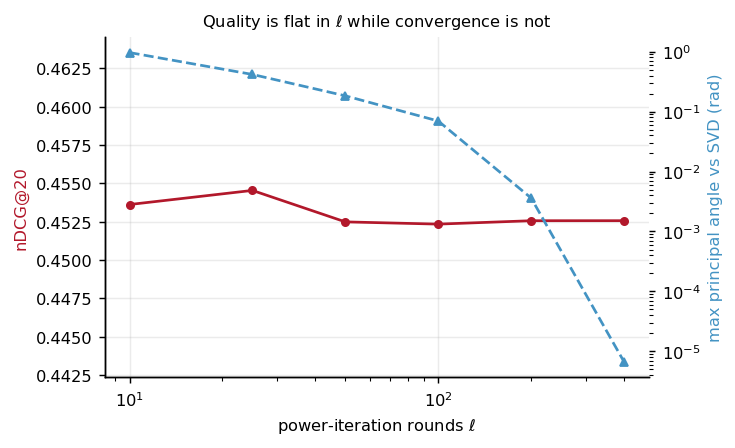

# Finding: recommendation quality is flat in the number of power iterations

**Measured 2026-09-06. Raw data: [`bench/results/oracle_ell_sweep.jsonl`](../bench/results/oracle_ell_sweep.jsonl).**
`py -3.13 model/ell_sweep.py` recomputes every row with the cleartext oracle and checks it against that file.

## What was measured

`ApproxFactor` in the clear (`model/mf.py`) on MovieLens-100K, split `u1`, at `d = 16`, sweeping the inner
power-iteration count `ell`.

| `ell` | Subspace angle against SVD (rad) | nDCG@20 | Recall@20 |
|---:|---:|---:|---:|
| 10 | 9.659e-01 | 0.4536 | 0.4693 |
| 25 | 4.170e-01 | 0.4545 | 0.4677 |
| 50 | 1.834e-01 | 0.4525 | 0.4650 |
| 100 | 6.966e-02 | 0.4523 | 0.4662 |
| 200 | 3.604e-03 | 0.4526 | 0.4664 |
| 400 | 6.652e-06 | 0.4526 | 0.4664 |

## What it means

**The implementation is correct.** The angle falls monotonically to 6.7e-06 radians, so the procedure converges to
the right subspace. The large angle at `ell = 10` is slow convergence and not a defect, and the spectrum explains the
rate: the sixteenth and seventeenth squared singular values differ by only about 3%, and power iteration converges as
a power of that ratio. The first component, with a ratio of 6.44, is easy. The sixteenth is not.

**Ranking does not need the singular vectors.** Across a fortyfold increase in `ell`, nDCG@20 stays between 0.4523 and
0.4545 with no monotone trend. A subspace good enough to keep the ordering of scores stable is enough.

## Why it matters for private training

Rounds and bytes grow linearly in `ell`, because truncation and normalisation run once per inner iteration and they are
most of the communication. So this says private training can run at `ell = 10`, and the fortyfold saving costs nothing in
recommendation quality. That is a design decision made on evidence, not a default.

## Caveats

- One dataset, one split, one seed, `d = 16`. The private path was later measured too, at `ell` from 1 to 50, and the
  flatness holds from `ell = 5` ([`train_quality.jsonl`](../bench/results/train_quality.jsonl)), with `ell = 1` and `ell = 2`
  visibly lower. Neither path was measured at MovieLens-1M or at `d = 32`, so the finding is not claimed there.
- nDCG@20 with binary relevance at a rating of 4 or more. Nudge's 0.29 is on Netflix data under its own convention, so
  these numbers are a within-project baseline and are not comparable to it.
- The argument applies to ranking quality. A use that needs the actual singular vectors would not inherit it.
