# Results

Everything OblivRec measured, with the figure and the data file behind each claim. All runs use
MovieLens-100K's `u1` split (943 users, 1,682 items) at `d = 16` and `ell = 10` unless stated.
Section 6 and Section 7 of the [final report](../report/final.pdf) cover these in full.

**How to read the numbers.** Rounds, bytes and quality are exact and repeat between runs. Absolute
times come from one laptop and drift by up to four times with its thermal state, so we quote ratios
from a single run, and give both values where a derived number moved between committed runs.
Wide-area times come from channel-level emulation, not real networks.

**Contents:** [the fetch](#why-the-fetch-has-to-be-private) ·
[cost](#what-the-composition-costs) · [quality](#recommendation-quality) ·
[wire and timing](#on-the-wire) · [malicious clients](#the-malicious-client) ·
[regenerating](#regenerating-everything)

---

## Why the fetch has to be private

The item matrix `B` is public by design, so an observed fetch is not one bit of information. It is a
direction, in a basis everyone holds, that points near the user's secret vector.

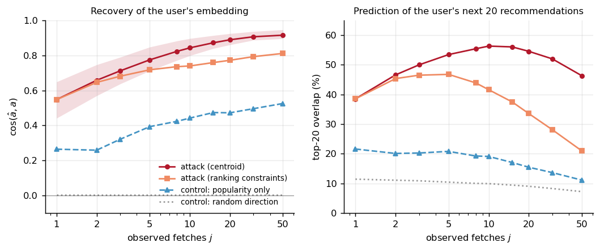

**One observed fetch gives a cosine of 0.55. Ten give 0.84, enough to name 56% of the user's next
twenty recommendations.** The observer sees only which items were fetched. The same estimator run on
the ten most popular items, ignoring the user, reaches 0.44, so the margin of about 0.40 is what is
learned about the individual. The margin is 0.28 after one fetch and between 0.38 and 0.42 from two
fetches on. A random direction scores 0.003. One user's cosine proves nothing, since a random direction's
interquartile range runs from −0.17 to 0.18, so only population means carry a claim.

A second estimator that uses strictly more information, that every fetched item outranks every
unfetched one, does worse from two fetches on (0.81 against 0.91 at fifty). The cheap, obvious attack
is already enough. Data: [`leakage_attack.jsonl`](../bench/results/leakage_attack.jsonl).

### Decoys do not fix it

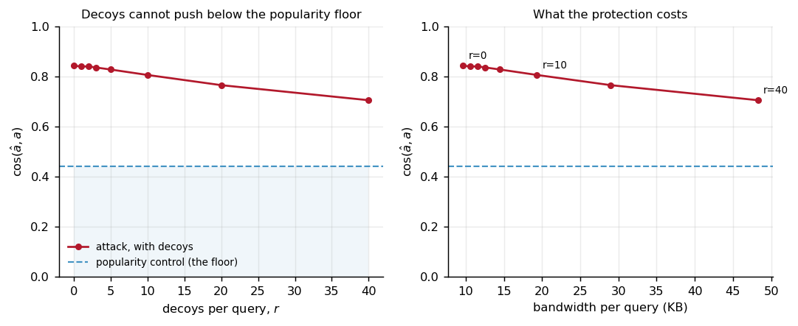

Forty decoys per query, five times the real traffic, only move the attack from 0.843 to 0.705, against
a popularity control at 0.442. Decoys have to be popular to be believable, so they pull the estimate
towards what the control already knows, and no further. Data:
[`leakage_attack.jsonl`](../bench/results/leakage_attack.jsonl).

### Nudge's own differential privacy does not fix it either

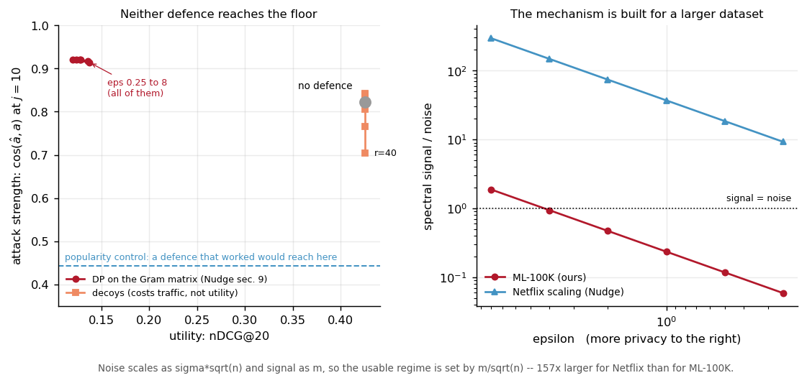

Nudge's Section 9 adds Gaussian noise to the Gram matrix inside power iteration. We implemented it,
taking the noise scale from Analyze Gauss, which it cites. We normalise rows to unit length, because
Nudge's division by rating count leaves 200 of our 943 users above the bound the privacy claim needs.

| | nDCG@20 | Attack cosine | Margin over control |
|---|---|---|---|
| No noise, rows normalised | 0.4255 | 0.8231 | 0.4324 |
| ε = 8 | 0.1361 | 0.9167 | 0.5044 |
| ε = 1, δ = 2⁻⁴⁰ | **0.1239** | **0.9212** | **0.4898** |

**Quality falls by 71%, and the attack gets stronger.** That is not a paradox. Differential privacy
bounds what `B` reveals about other people's ratings, while the attack recovers this user's vector
using `B` as a known map. User and observer share the same noisy `B`, so the geometry survives, and
what the noise destroys is the popularity structure the control relies on.

**Why we lose 71% where Nudge loses 17%.** Nudge reports nDCG@20 falling from 0.29 to 0.24 on Netflix.
Noise grows with `σ√n` and signal with `m`, so what matters is `m/√n`, which is 157 times larger for
Netflix than for MovieLens-100K. On our data the noise beats the signal by a factor of 4.2. That is
about our dataset's scale, and it does not contradict the paper. Data:
[`dp_study.jsonl`](../bench/results/dp_study.jsonl).

---

## What the composition costs

### Each half, isolated

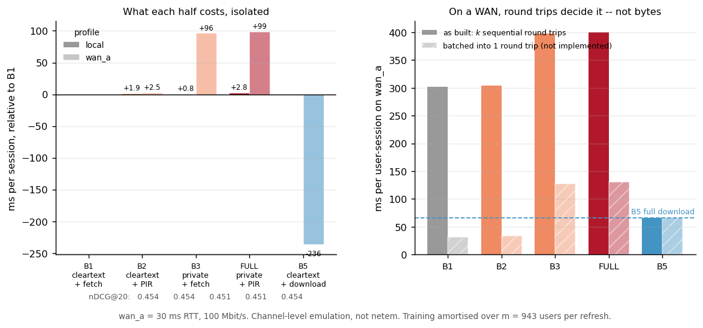

| Arm | Training, delivery | Bytes per session | Rounds | `wan_a` (ms) | nDCG@20 |
|---|---|---|---|---|---|
| B1 | clear, clear | 2,600 | 10 | 301.4 | 0.454 |
| B2 | clear, DPF-PIR | 9,660 | 10 | 303.9 | 0.454 |
| B3 | private, clear | 71,264 | 13 | 397.7 | 0.451 |
| **FULL** | **private, DPF-PIR** | **78,324** | **13** | **400.2** | **0.451** |
| B5 | clear, full download | 430,592 | 1 | 65.6 | 0.454 |

Training is shared across the 943 users one run serves. `wan_a` is 30 ms round trip at 100 Mbit/s.

**Composing costs exactly the sum of the halves.** FULL = B2 + B3 − B1 holds to the byte. Over a whole
training run plus one session it is 64,760,124 bytes, and the benchmark asserts the identity before
writing a row. Private delivery adds 2.5 ms per session and private training adds 96 ms.

**The result that goes against us.** On `wan_a`, B5 is 4.6 times faster than B2 although it sends 45
times as many bytes. We fetch ten films one after another, so we pay ten round trips, and B5 pays
one. Batching the ten queries into one trip would take 33.9 ms against B5's 65.6 ms, by our model. We
did not build it, and the benchmark marks those rows as not implemented. Data:
[`bench_compose.jsonl`](../bench/results/bench_compose.jsonl).

### Scaling, and Nudge's Theorem 4.2 measured

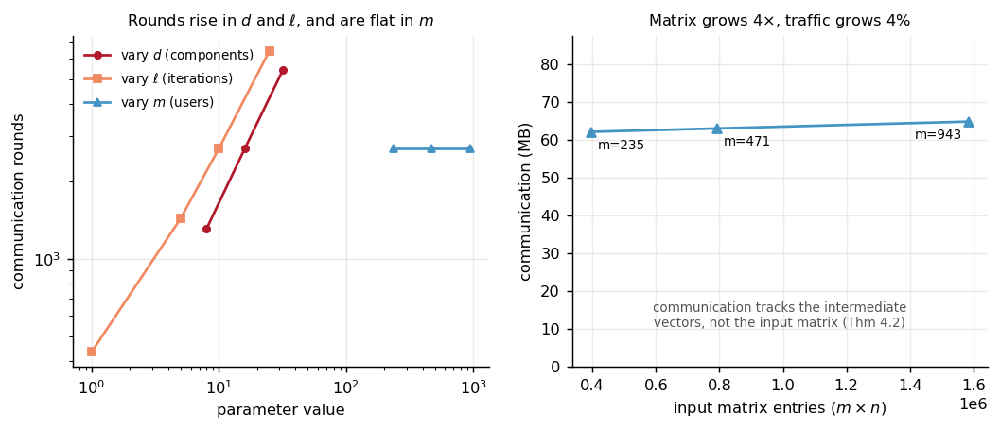

Quadrupling the input matrix, from 235 to 943 users, moves traffic from 62.03 to 64.75 MB, an increase
of 4.4%, and leaves rounds at 2,686. The increase is exactly linear at 3,840 bytes per added user, which
is the one term that depends on `m`: 160 iterations × 3 parties × 8 bytes. Communication follows the
vectors in the computation, not the matrix. Training is round-bound: on `wan_a` one run takes 85.8 s, of
which 80.6 s is latency and 5.2 s is transfer. The sweep varies one factor at a time, so interactions
are not measured. Data: [`bench_sweep.jsonl`](../bench/results/bench_sweep.jsonl).

### Where the rounds go

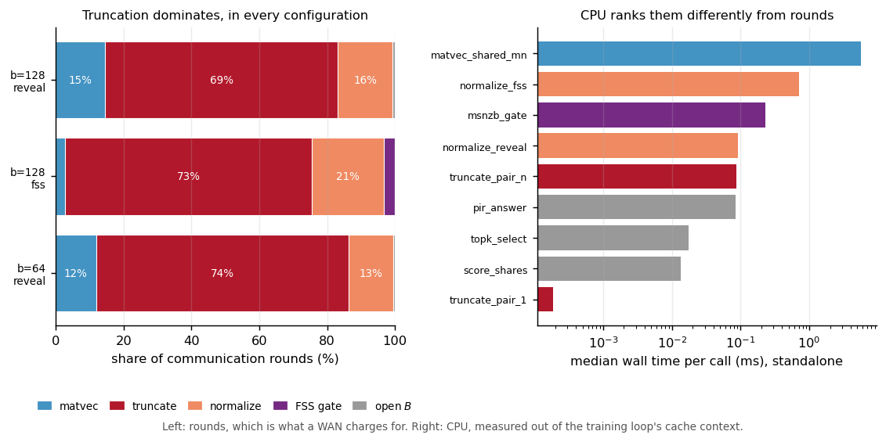

| Stage | Reveal, `b = 64` | Reveal, `b = 128` | No leak, `b = 128` |
|---|---|---|---|
| Matrix-vector | 320 rounds (11.9%) | 320 (14.6%) | 320 (2.8%) |
| **Truncation** | **1,998 (74.4%)** | **1,503 (68.6%)** | **8,367 (72.6%)** |
| Normalisation | 352 (13.1%) | 352 (16.1%) | 2,464 (21.4%) |
| FSS gate | 0 | 0 | 352 (3.1%) |
| Opening `B` | 16 (0.6%) | 16 (0.7%) | 16 (0.1%) |
| **Total** | **2,686** | **2,191** | **11,519** |

Truncation is 68.6 to 74.4% of rounds and 75.1 to 83.4% of bytes. The comparison gate, the part that
looks exotic, is 3.1%. The breakdown is a closed form validated against a real run, with a residual of
zero rounds and zero bytes in all three configurations, so these are shares of a complete budget. CPU
ranks the stages differently, so which one matters depends on where the servers sit. Data:
[`bench_stages.jsonl`](../bench/results/bench_stages.jsonl).

### One private read against its alternatives

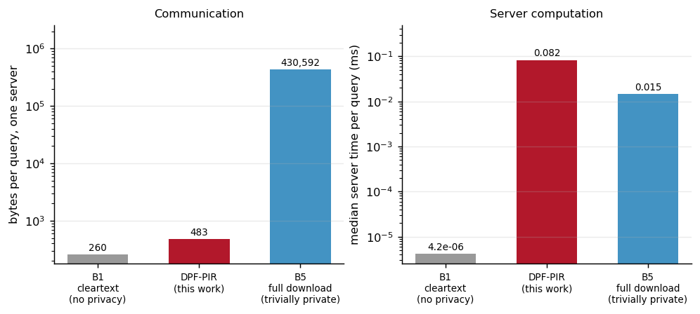

DPF-PIR sends 483 bytes per server, 446 times fewer than downloading the catalogue, counting both
servers. It is also the slowest of the three in server CPU, about five times the download's local copy
(5.3 and 5.6 in two committed runs). Setting the extra CPU against the saved bytes, the private read wins
on links below 8.0 Gbit/s in one run and 22.9 Gbit/s in the other. That crossover comes from absolute
times, so it moves. Data: [`bench_baseline.jsonl`](../bench/results/bench_baseline.jsonl).

### Query size

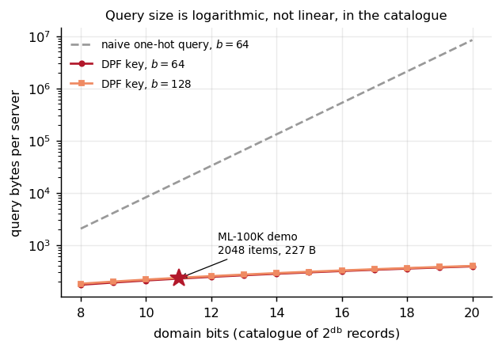

A key grows by 18 bytes per domain bit while a naive query doubles. At our 2,048-record catalogue that
is 227 bytes against 16,384. The closed form plotted is the one
[`tests/test_dpf_serialize.cpp`](../tests/test_dpf_serialize.cpp) asserts equal to the serialised length.

### How wide the ring must be

Two answers, for two reasons. **Arithmetic:** at `t = 20` and `b = 64` training fits at MovieLens-100K,
MovieLens-1M and Netflix size, with 21, 18 and 11 spare bits, but only with the immediate truncation
schedule. At `t = 24` and Netflix size no safe schedule exists. These larger scales are derived from
public parameters, not run. **The mask:** the no-leak comparison gate needs at least 81 bits to hide its
input, so a 64-bit ring cannot run the normaliser that reveals nothing, at any scale. Data:
[`train.jsonl`](../bench/results/train.jsonl).

---

## Recommendation quality

| `ell` | Reveal, `b = 64` | Reveal, `b = 128` | **No leak, `b = 128`** | Cleartext oracle |
|---|---|---|---|---|
| 1 | 0.3729 | 0.3727 | **0.1651** | 0.3664 |
| 2 | 0.4251 | 0.4248 | 0.4230 | 0.4220 |
| 5 | 0.4485 | 0.4490 | 0.4448 | 0.4455 |
| 10 | 0.4511 | 0.4513 | 0.4493 | 0.4536 |
| 25 | 0.4532 | 0.4531 | 0.4499 | 0.4545 |
| 50 | 0.4531 | 0.4532 | 0.4502 | 0.4525 |

Private training stays within 0.007 of the oracle at every `ell` on the revealing path. For every
`ell` of 2 or more, revealing nothing costs between 0.0018 and 0.0041. The middle revealing column is the control: it
shares the no-leak path's ring and schedule, and the two revealing columns differ by at most 0.0005, so
the normaliser accounts for the whole gap. What revealing nothing costs instead is rounds, by a factor
of 5.3. At `ell = 1` the no-leak path collapses to 0.1651. Nobody would run it there, but the cliff is
sharp, so we report it. Data: [`train_quality.jsonl`](../bench/results/train_quality.jsonl).

**How this measurement found a bug.** The first no-leak run at `ell = 10` scored 0.3428 against 0.4513.
The cause was a comparison gate range copied from elsewhere: out-of-range values clamp silently, Newton
starts from the wrong power of two, and the iteration never converges. Rounds and bytes are identical
with the wrong range, so no cost benchmark could see it. With the range fixed, the gap is 0.0020. The
rows from the buggy run were not kept, so 0.3428 is recorded in commit `d2138ad` and at the gate's call
site in [`src/apps/train.cpp`](../src/apps/train.cpp), not in the committed data.

### Quality is flat in the number of iterations

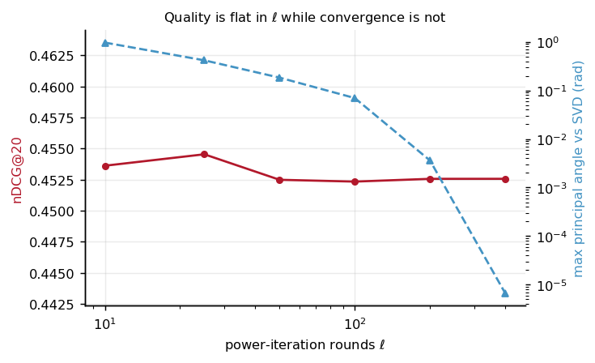

Across a fortyfold increase in `ell`, nDCG@20 stays between 0.4523 and 0.4545 while the angle to the true
singular subspace falls by five orders of magnitude. Ranking needs a stable subspace, not exact singular
vectors, and since rounds grow linearly in `ell`, this is why `ell = 10` is the operating point. More in
[the original finding](finding-ell-vs-quality.md). Data:
[`oracle_ell_sweep.jsonl`](../bench/results/oracle_ell_sweep.jsonl).

---

## On the wire

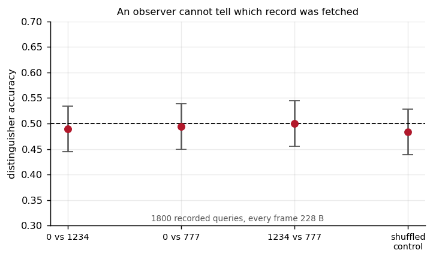

Over 1,800 recorded queries across three record indices, every query frame is 228 bytes and every reply
is 265 bytes. A logistic-regression classifier on the raw frame bytes scores between 0.490 and 0.500 on
held-out pairs, with chance inside every 95% interval, and the same pipeline on shuffled labels scores
0.483. This is one adversary on one feature representation, not a proof. It rules out the failure that
actually happens in practice, a length or byte pattern that correlates with the query. Data:
[`distinguisher_result.jsonl`](../bench/results/distinguisher_result.jsonl).

### Server-side timing

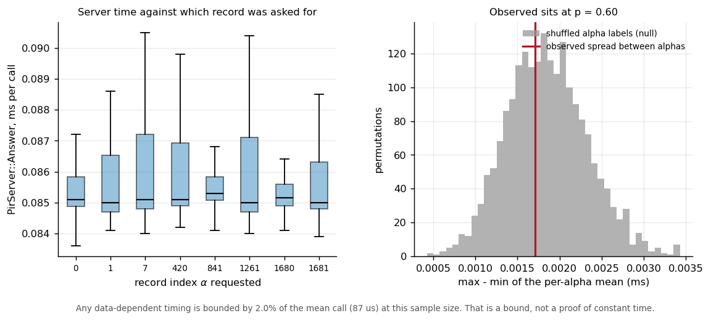

The answer routine, timed 200 times at each of eight records, interleaved so thermal drift cannot line
up with the record. The mean call is 87 µs. The spread between records is 1.7 µs, smaller than the 6.0 µs
of noise within one record, and a permutation test gives p = 0.60. **This bounds any record-dependent
signal below 2.0% of a call at this sample size. It is not a proof of constant time.** That bound belongs
to this committed run. A later rerun, while another build was using the machine, again found no record
dependence (p = 0.30) but a looser bound of 11.7% of a 199 µs call, because the noise was higher. Those
rows are not committed. Timing on the wire itself is not analysed. Data:
[`bench_timing.jsonl`](../bench/results/bench_timing.jsonl).

---

## The malicious client

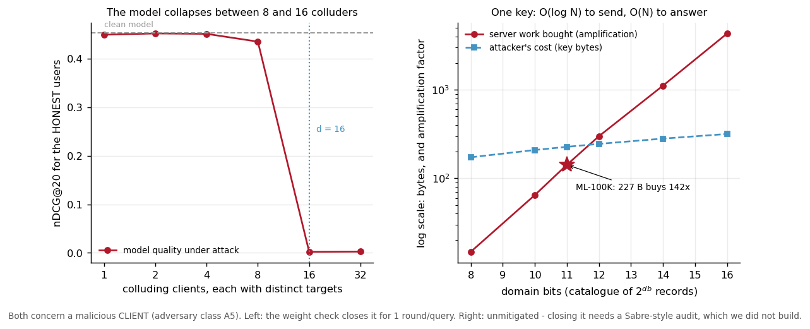

Once delivery feeds training, a query is also a vote. Nothing stopped a client generating keys with
`beta = 10^6` instead of 1: retrieval still works, and the servers add a million to the consumption
counts. [`tests/test_harvest.cpp`](../tests/test_harvest.cpp) demonstrates it.

| Attackers, weight 10⁶ | Honest users' nDCG@20 | Change |
|---|---|---|
| None | 0.4536 | |
| 1 | 0.4493 | −1.0% |
| 8, distinct targets | 0.4351 | −4.1% |
| **16, distinct targets** | **0.0021** | **−99.5%** |

One attacker can do little, because power iteration normalises at every step, so extra weight only
fixes a direction, and the targets do not even rise. Colluders with distinct targets are another matter.
We ran only powers of two, so the data place the collapse between 8 and 16 colluders.

**The fix, and its limit.** Each server sums its own expansion, and the two sums differ by exactly `beta`,
so opening that one scalar costs one round and two elements per query and reveals nothing about the
film. That closes weight inflation. It does not close redistribution: a forged key can place +2 at one
film and −1 at another and still sum to one, and the test constructs exactly that forgery. Closing it
needs a proof that a key encodes a real point function, which is what Sabre's audit does, and we did not
build it.

**Denial of service.** A key is logarithmic in the catalogue and answering it is linear, so a small query
buys a lot of server work. At our 11-bit domain a 227-byte key buys 142 times its own cost in the run
shown, and 121 times in an earlier committed run. At 16 bits that run measures 4,323 times. The linear
work is the privacy property, so this is privacy paid for in availability, and it stays unmitigated. Data:
[`poison_study.jsonl`](../bench/results/poison_study.jsonl), [`bench_dos.jsonl`](../bench/results/bench_dos.jsonl).

---

## Regenerating everything

```bash
mingw32-make figures          # all 12 figures from the committed rows, for the report
mingw32-make readme-figures   # the same figures as the PNGs on this page
py -3.13 bench/scripts/check_claims.py --deck report/slides/OblivRec_final_presentation.pptx
mingw32-make reproduce        # the whole pipeline from a clean checkout, about 13 minutes
```

`check_claims.py` recomputes the stated numbers from the committed rows and checks them against the
report, the slides, the speaker script, the README, the threat model and this page. A fresh clone ran
`reproduce` to exit 0 in 762 seconds. On the rows that run appended, 74 of the 85 numbers then checked came
out identical, and the 11 that moved are all wall-clock times, as the note at the top of this page says
they will.

Appendix B of the [report](../report/final.pdf) maps every figure to the command that writes its data.
